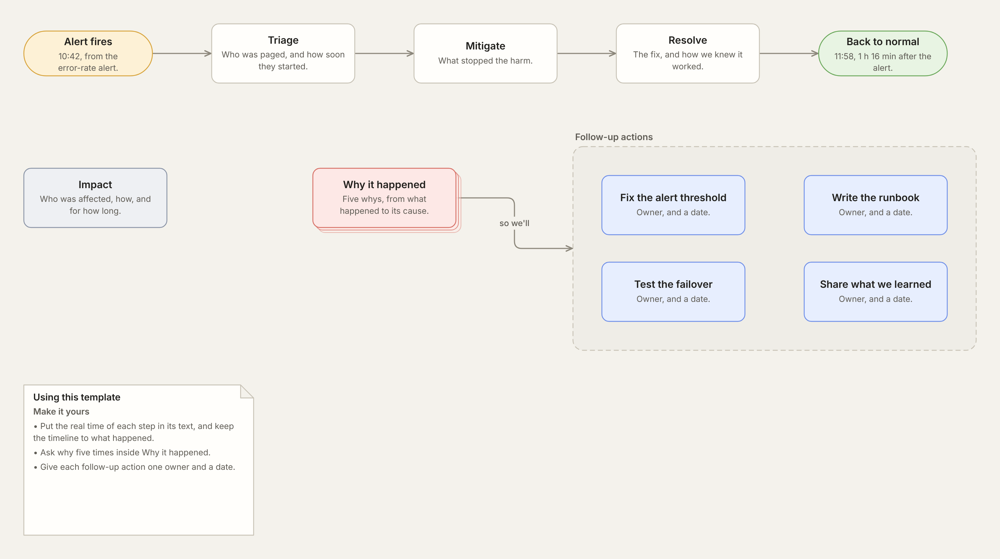
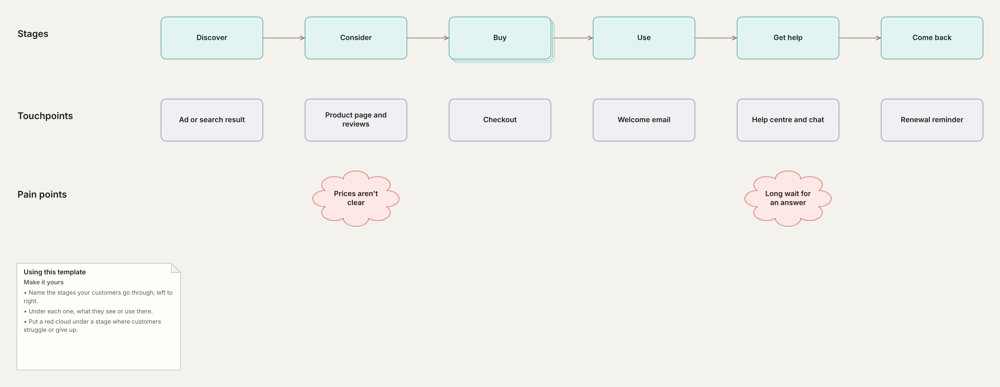
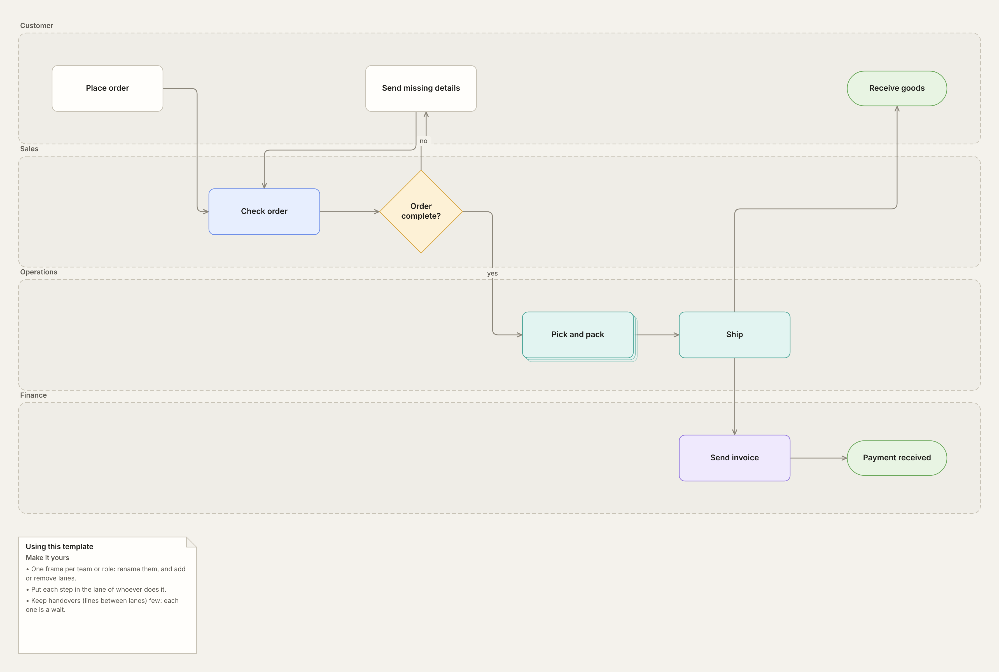
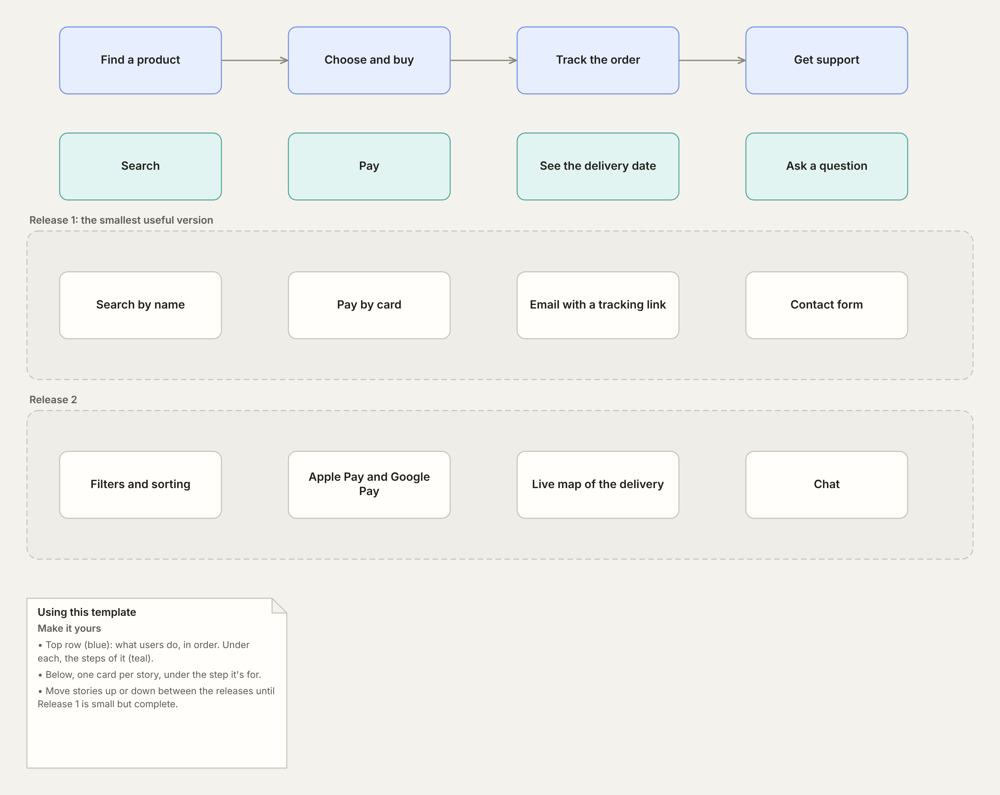
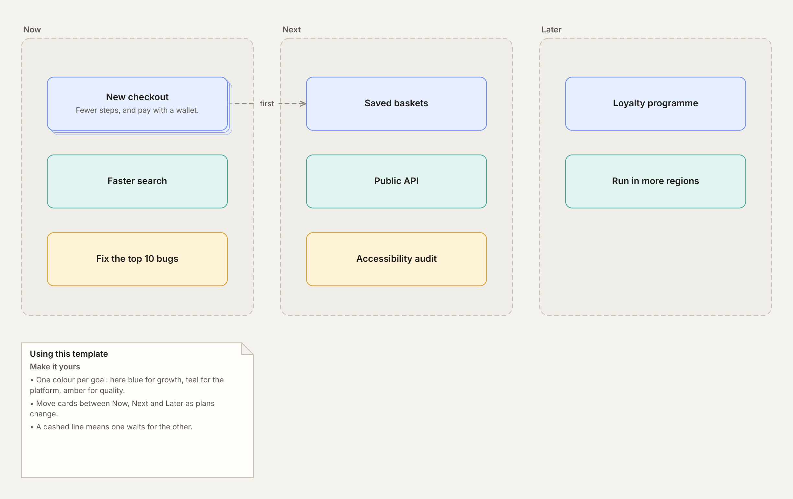
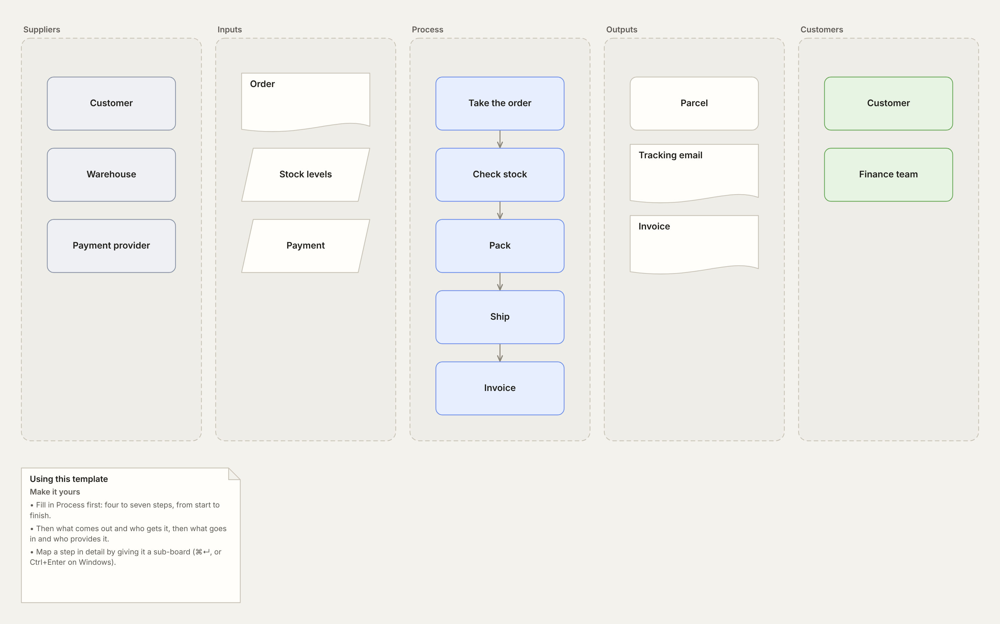
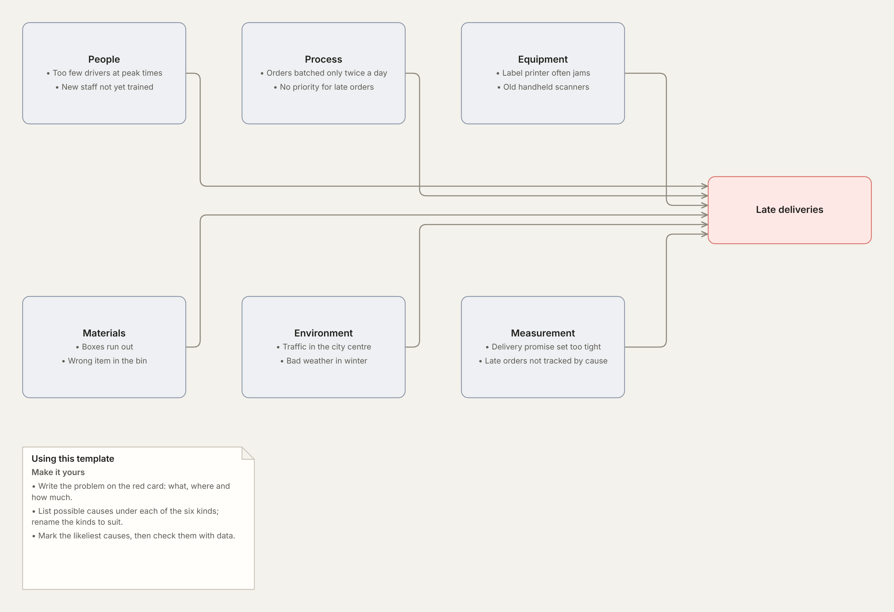
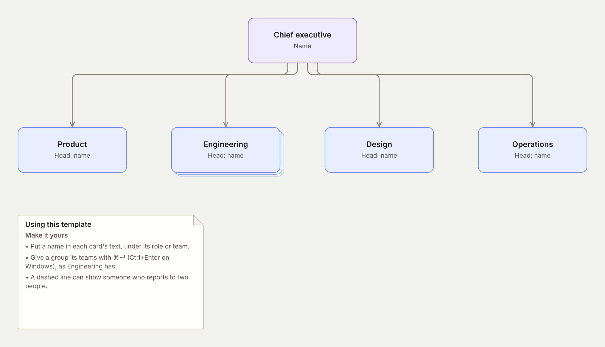

# nemoboard templates

Ready-made boards to start a [nemoboard](https://nemoboard.com) project from. Each template is an ordinary nemoboard project: a folder of `.nemo.md` markdown files, with `index.nemo.md` as the top board and a file for each sub-board.

## Using a template

Choose **Open in nemoboard** beside a template below. It opens on nemoboard.com as a new project, named after the template and kept in your browser. Rename the cards and make it yours.

The first four are also built into nemoboard: choose **New from template…** in the project menu.

To keep a copy of the files, choose **Download .zip** instead, then **Import ▸ .zip file…** in nemoboard's project menu. In Chrome or Edge you can also unzip it and choose **Open folder…** to work on the files on disk.

## Templates

| | Template | What it's for |
| --- | --- | --- |
|  | **[Process map](templates/process-map)** [Open in nemoboard](https://nemoboard.com/?template=process-map) · [Download .zip](https://github.com/Matthew-Hounslow/nemoboard-templates/releases/download/templates/process-map.zip) | A flow from where it starts to where it ends, with a decision and the branch it leads to. |
|  | **[System overview](templates/system-overview)** [Open in nemoboard](https://nemoboard.com/?template=system-overview) · [Download .zip](https://github.com/Matthew-Hounslow/nemoboard-templates/releases/download/templates/system-overview.zip) | Who uses a system, what it's made of and what it relies on. Web app and API open into their parts. |
|  | **[Decision tree](templates/decision-tree)** [Open in nemoboard](https://nemoboard.com/?template=decision-tree) · [Download .zip](https://github.com/Matthew-Hounslow/nemoboard-templates/releases/download/templates/decision-tree.zip) | One question at the top, a decision at each branch and an outcome at each end. |
|  | **[Value stream map](templates/value-stream)** [Open in nemoboard](https://nemoboard.com/?template=value-stream) · [Download .zip](https://github.com/Matthew-Hounslow/nemoboard-templates/releases/download/templates/value-stream.zip) | How work flows from order to delivery: each step's time, place and people, and the problems to fix. |
|  | **[Incident review](templates/incident-review)** [Open in nemoboard](https://nemoboard.com/?template=incident-review) · [Download .zip](https://github.com/Matthew-Hounslow/nemoboard-templates/releases/download/templates/incident-review.zip) | A blameless review: the timeline, the impact and follow-up actions. Why it happened opens into five whys. |
|  | **[Customer journey](templates/customer-journey)** [Open in nemoboard](https://nemoboard.com/?template=customer-journey) · [Download .zip](https://github.com/Matthew-Hounslow/nemoboard-templates/releases/download/templates/customer-journey.zip) | The stages a customer goes through, what they touch at each one and where it hurts. Buy opens into its steps. |
|  | **[Swimlane process](templates/swimlane-process)** [Open in nemoboard](https://nemoboard.com/?template=swimlane-process) · [Download .zip](https://github.com/Matthew-Hounslow/nemoboard-templates/releases/download/templates/swimlane-process.zip) | One process across the teams that share it, a lane each, so every handover shows. Pick and pack opens into its steps. |
|  | **[User story map](templates/user-story-map)** [Open in nemoboard](https://nemoboard.com/?template=user-story-map) · [Download .zip](https://github.com/Matthew-Hounslow/nemoboard-templates/releases/download/templates/user-story-map.zip) | What users do, left to right, and the stories under each step, sliced into releases you can ship. |
|  | **[Product roadmap](templates/product-roadmap)** [Open in nemoboard](https://nemoboard.com/?template=product-roadmap) · [Download .zip](https://github.com/Matthew-Hounslow/nemoboard-templates/releases/download/templates/product-roadmap.zip) | Now, Next and Later, coloured by goal. New checkout opens into its milestones. |
|  | **[SIPOC](templates/sipoc)** [Open in nemoboard](https://nemoboard.com/?template=sipoc) · [Download .zip](https://github.com/Matthew-Hounslow/nemoboard-templates/releases/download/templates/sipoc.zip) | Suppliers, inputs, process, outputs and customers: a process on one page, before mapping it in detail. |
|  | **[Cause and effect](templates/cause-and-effect)** [Open in nemoboard](https://nemoboard.com/?template=cause-and-effect) · [Download .zip](https://github.com/Matthew-Hounslow/nemoboard-templates/releases/download/templates/cause-and-effect.zip) | A fishbone diagram: one problem, and its possible causes sorted into six kinds. |
|  | **[Team structure](templates/team-structure)** [Open in nemoboard](https://nemoboard.com/?template=team-structure) · [Download .zip](https://github.com/Matthew-Hounslow/nemoboard-templates/releases/download/templates/team-structure.zip) | An org chart: who leads what. Engineering opens into its teams. |

## Adding a template

New templates are welcome. [CONTRIBUTING.md](CONTRIBUTING.md) explains how to make one and send it in.

## Licence

The templates are shared under the [Creative Commons Attribution 4.0 International licence](LICENSE) (CC BY 4.0). You may use, change and share them, including commercially, as long as you give credit as the licence describes: name "nemoboard templates", link to this repository and say if you changed anything.
