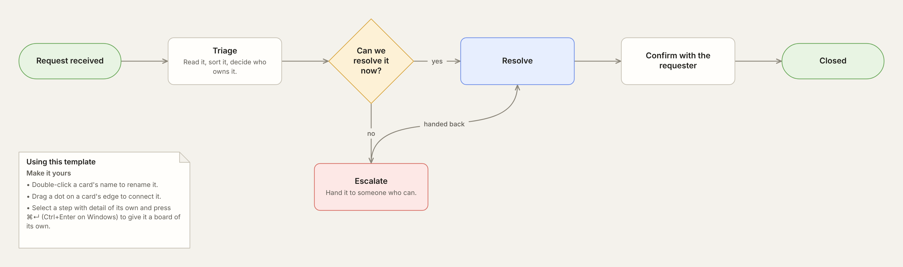
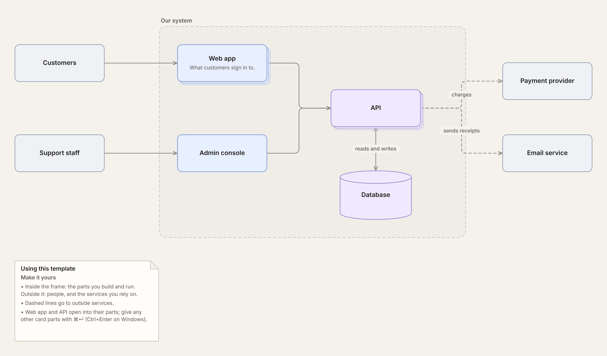
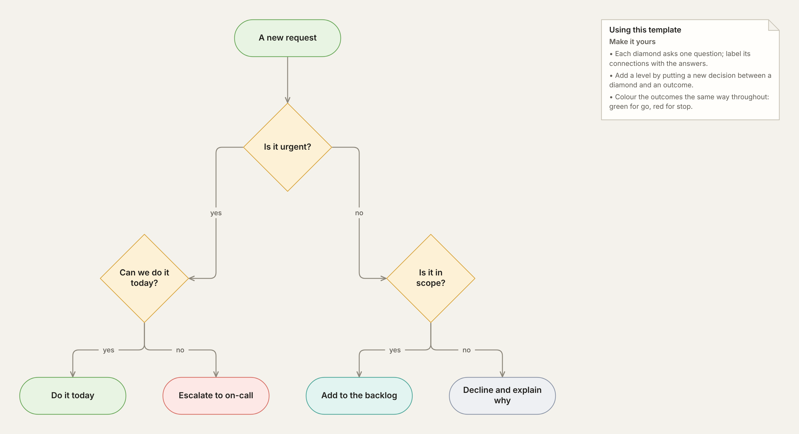
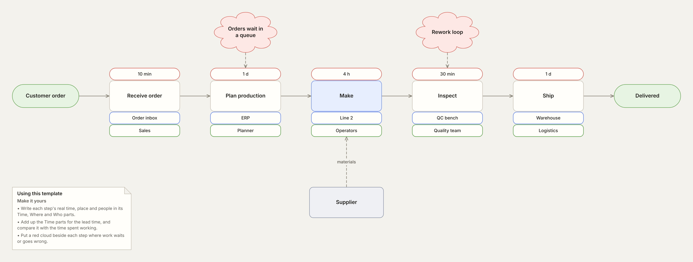

# nemoboard templates

Ready-made boards to start a [nemoboard](https://nemoboard.com) project from. Each template is an ordinary nemoboard project: a folder of `.nemo.md` markdown files, with `index.nemo.md` as the top board and a file for each sub-board.

## Using a template

Choose **Open in nemoboard** beside a template below. It opens on nemoboard.com as a new project, named after the template and kept in your browser. Rename the cards and make it yours.

The first four are also built into nemoboard: choose **New from template…** in the project menu.

To keep a copy of the files, choose **Download .zip** instead, then **Import ▸ .zip file…** in nemoboard's project menu. In Chrome or Edge you can also unzip it and choose **Open folder…** to work on the files on disk.

## Templates

| | Template | What it's for |
| --- | --- | --- |
|  | **[Process map](templates/process-map)** [Open in nemoboard](https://nemoboard.com/?template=process-map) · [Download .zip](https://github.com/Matthew-Hounslow/nemoboard-templates/releases/download/templates/process-map.zip) | A flow from where it starts to where it ends, with a decision and the branch it leads to. |
|  | **[System overview](templates/system-overview)** [Open in nemoboard](https://nemoboard.com/?template=system-overview) · [Download .zip](https://github.com/Matthew-Hounslow/nemoboard-templates/releases/download/templates/system-overview.zip) | Who uses a system, what it's made of and what it relies on. Web app and API open into their parts. |
|  | **[Decision tree](templates/decision-tree)** [Open in nemoboard](https://nemoboard.com/?template=decision-tree) · [Download .zip](https://github.com/Matthew-Hounslow/nemoboard-templates/releases/download/templates/decision-tree.zip) | One question at the top, a decision at each branch and an outcome at each end. |
|  | **[Value stream map](templates/value-stream)** [Open in nemoboard](https://nemoboard.com/?template=value-stream) · [Download .zip](https://github.com/Matthew-Hounslow/nemoboard-templates/releases/download/templates/value-stream.zip) | How work flows from order to delivery: each step's time, place and people, and the problems to fix. |

## Adding a template

New templates are welcome. [CONTRIBUTING.md](CONTRIBUTING.md) explains how to make one and send it in.

## Licence

The templates are shared under the [Creative Commons Attribution 4.0 International licence](LICENSE) (CC BY 4.0). You may use, change and share them, including commercially, as long as you give credit as the licence describes: name "nemoboard templates", link to this repository and say if you changed anything.
